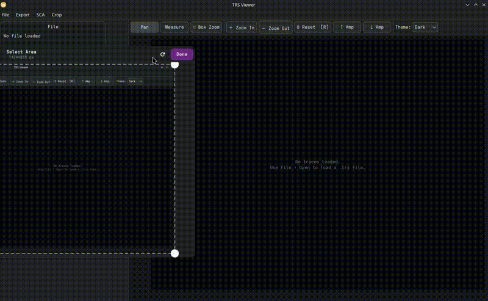

# Welch T-Test

**Analyze → Welch t-test (TVLA)…**

Computes the per-sample Welch t-statistic between two trace groups. No special header fields are required — group assignment is configured in the dialog by choosing which data byte to use as the group label (0 = group 0, non-zero = group 1). If the file's parameter map contains a `ttest` entry, its `offset` field is used automatically and the byte selector is hidden.

## Live progress

With **Show intermediate results while it runs** ticked (the default), a
*Live t-test* tab opens as soon as you click **Run t-test**. While the job runs
it shows:

- **The t-curve so far,** recomputed every *N* traces (**Update every**, and at
  most a few times per second). The previous three snapshots are drawn faded
  behind the current one, so you can watch real leakage peaks grow while noise
  stays put. Overlays switch off automatically for traces longer than 2 million
  samples, to save memory.
- **max |t| vs traces processed,** a small plot under the controls. It is the
  classic "traces to disclosure" view, and the status line notes when |t| first
  went over the threshold.
- **Progress:** traces done, traces per second, time remaining, the number of
  traces per group, and how many samples are currently over the threshold.

The controls:

| Button | Effect |
|---|---|
| **Pause / Resume** | Hold the run between batches. |
| **Stop & Keep Result** | End now and open the full result tab for the traces processed so far. |
| **Cancel** | Abort and discard. |

When the run ends, the normal result tab described below opens next to the
live tab, which keeps the history. The live tab can be closed at any time; the
job carries on.

!!! note "Random trace order"
    **Random trace order** (on by default) processes the traces in a fixed
    pseudo-random order. If a file stores all of one group first and then the
    other, file order would make early snapshots lopsided, or impossible until
    the second group starts. The final result is the same in either order,
    apart from floating-point rounding in the last digits.

!!! warning "The first crossing is only indicative"
    Looking at the curve after every update and stopping when it crosses 4.5
    is repeated testing, which raises the false-positive rate. Treat the first
    crossing as a hint, and judge the final result with **Calc TH…**.

## Result tab

The result tab has a single row of controls; pan, zoom, measure and amplitude
come from the main toolbar, as for any tab.

- **Threshold ±**: adjustable threshold line (orange dashed)
- **One-sided**: show only the positive threshold (for abs-preprocessed signals)
- **Calc TH…** — significance-threshold calculator. The per-sample level for an overall type-I error rate α over `n_L` samples uses the **Šidák** correction `α_TH = 1 − (1 − α)^(1/n_L)`, and the threshold is `TH = CDF_t⁻¹(1 − α_TH/2, ν̂)` with Welch–Satterthwaite degrees of freedom computed from the trace data. The dialog reports both the median and approximate ν̂. Follows Zhang, Ding, Durvaux, Standaert & Fei, *Towards Sound and Optimal Leakage Detection Procedure* (IACR ePrint 2017/287, EuroS&P 2018)
- **Cut**: drag across the plot to cut a region out of the exported result
- **Trim ▾**: exclude a number of samples at the start or end; the exported length is shown next to it while trimmed
- **Style…**: plot title, line width, trace colour, dark/light theme
- **Export ▾**: PNG image, PDF (A4 landscape vector), curve as `.npz`, or curve as TRS

**File → Load Result → t-test Curve (NPY)…** — load a pre-computed 1-D `float32` t-statistic vector.

